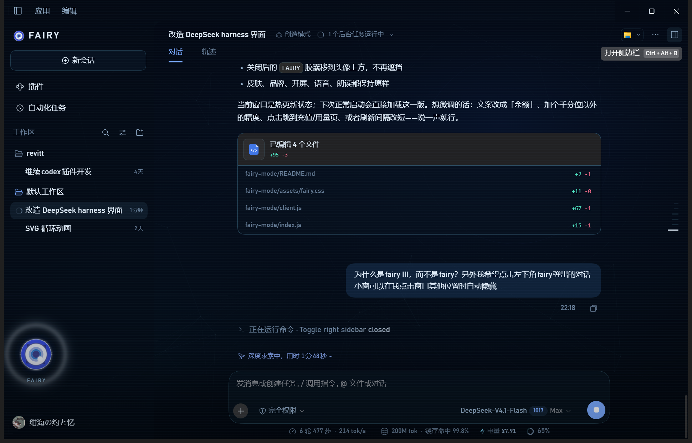
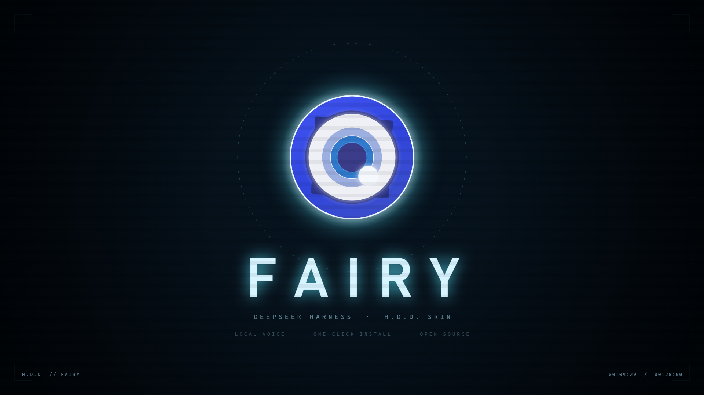
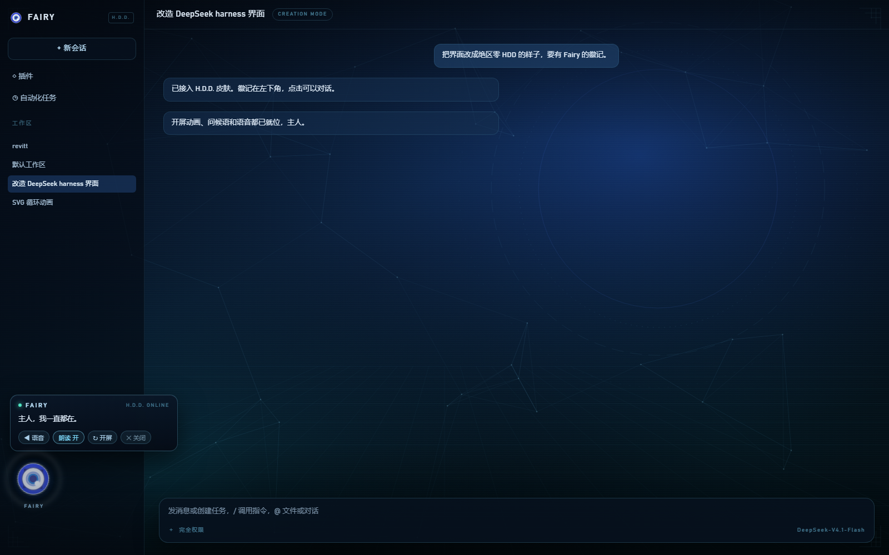

# FAIRY · DeepSeek Harness HDD 皮肤

把 DeepSeek Harness 桌面端改成《绝区零》HDD 系统的样子：开机动画、Fairy 徽记、暗色 HUD、语音问候与朗读、输入框下方的「剩余电量」。

这是为 **DSH 桌面端（Electron）** 写的 Cordis 插件包 `@local/dsh-fairy-mode`，Host 半 + Client 半都在本仓库里。



## 一键安装

Windows PowerShell：

```powershell
powershell -ExecutionPolicy Bypass -Command "irm https://raw.githubusercontent.com/unknown-sama-ff/dpsk-fairy/main/install.ps1 | iex"
```

脚本会自动把皮肤装进当前用户的 DSH profile，装完**完全退出并重启 DeepSeek Harness** 即可看到开屏动画和新界面。

卸载：仓库内运行 `uninstall.ps1`。

## 让 AI agent 帮你装

直接把仓库丢给你的 coding agent，说「根据这个仓库帮我改主题」即可——仓库根目录的 [AGENTS.md](AGENTS.md) 写明了安装、重启、验收和排障步骤。

## 功能

- **暗色 HUD 皮肤**：深蓝底 + 扫描线 + 网格背景，侧栏/气泡/输入框/菜单全套 token 覆盖，`fairy` 主题可随时开关。
- **开屏动画**：启动先播 HDD 开机动画（可点击 / ESC 跳过），随后问候并归位到左下角；重启默认进入 FAIRY 模式。
- **Fairy 徽记**：左下角点击弹对话小窗（语音开关、朗读开关、重播开屏、关闭皮肤），**点窗口其他位置自动收起**，Esc 也可关闭。
- **侧栏品牌**：左上角替换为 `FAIRY` 徽记 + 字标；新会话 Hero 标题换成「欢迎回来，法厄同」。
- **语音**：本地 GPT-SoVITS v2 推理（Fairy 音色），失败自动回退 edge-tts；支持整段自动朗读、单条消息朗读。
- **剩余电量**：输入框下方统计行最右侧显示 `⚡ 电量 ¥x.xx`（账户余额），60 秒 / 窗口聚焦时刷新。
- **人设**：Host 向 system prompt 注入 Fairy 人设段（称呼「主人」、冷静精准）。

## 宣传片

[](promo/fairy-promo.mp4)

28 秒 · 1920×1080 · 30fps · 带中文语音与音效：[promo/fairy-promo.mp4](promo/fairy-promo.mp4)

片源可复现：`promo/stage.html` 是 Canvas 时间线（28s 分镜：信号 → 徽记 → 开机 → 界面 → 徽记对话 → 电量 → 语音 → 安装 → 片尾），`promo/render.mjs` 用 CDP 逐帧截图并交给 ffmpeg 合成音轨。

## 截图

| 开屏 | 问候 | 徽记 + 对话 |
|---|---|---|
|  |  |  |

## 目录结构

```
fairy-mode/                 # 插件包（可直接链进 DSH profile）
├── client.js               # Client 半：主题、皮肤、开屏/问候/徽记、朗读、电量
├── index.js                # Host 半：/fairy 路由、TTS、余额、人设
├── assets/                 # 开屏视频、壁纸、徽记、CSS、预览页
├── preview/                # 设计预览与实机截图
├── locale/                 # 中英文案
├── cordis.patch.yml        # 插件在 profile 里的 patch 片段
└── README.md               # 插件自身的安装/配置/卸载说明
```

## 安装（DSH 桌面端）

1. 把 `fairy-mode/` 放到你的工作区（例如 `Documents/deepseek-harness/default-workspace/fairy-mode`）。
2. 在 profile（默认 `~/.dsh/profiles/desktop`）里把它登记为本地 bundle：
   - `package.json` 的 dependencies 指向该目录，`pnpm install` 生成链接；或直接把目录 softlink 进 `node_modules/@local/dsh-fairy-mode`。
3. 在 `cordis.patch.yml` 里加：

   ```yaml
   - id: fairy-mode
     name: '@local/dsh-fairy-mode'
     config:
       persona: true
       voice: true
       tts:
         engine: auto          # auto | gpt-sovits | edge
         url: http://127.0.0.1:9880
   ```

4. **重启一次 DeepSeek Harness**（桌面端在启动时缓存客户端模块图，新插件只有重启后才会挂载）。

更完整的说明见 [fairy-mode/README.md](fairy-mode/README.md)。

## 语音

- **开箱有声**：仓库自带 `fairy-mode/assets/voice/*.mp3`（欢迎词、三句闲聊、开机词）和内置 edge-tts，装上即可听到问候。
- **Fairy 本音（可选）**：在本机跑 GPT-SoVITS v2 推理，Host 会自动拉起 `api_v2.py`（127.0.0.1:9880），`/fairy/tts` 返回 `audio/wav`，失败自动回退 edge-tts。完整搭建步骤（底模、权重、兼容补丁、语音包重生成）见 [docs/VOICE.md](docs/VOICE.md)。
- 权重与参考音频不进 git：获取渠道见 [docs/VOICE.md](docs/VOICE.md#0-权重和参考音频从哪来)（第三方教程仓库 [fairy-stackchan/voice-package](https://github.com/Michae1o/fairy-stackchan/tree/main/voice-package) + 网盘）。请勿二次分发。
- 语音包重生成脚本：`tools/gen_voice.py`；仓库自带的 mp3 就是用这套模型生成的。
- 相关配置在 `config.tts`：`engine`、`url`、`gptDir`、`python`、`refAudio`、`promptText`、`promptLang`、`autoStart`。

## 语音（可选）

仓库不含模型和语音运行时，只含调用逻辑：

- 本地推理用 **GPT-SoVITS v2**（`Fairy-e10.ckpt` + `Fairy_e10_s870.pth`），参考音色约 5–6 秒。
- Host 启动时会自动拉起 `api_v2.py`（127.0.0.1:9880）；`/fairy/tts` 返回 `audio/wav`，任何失败回退到 edge-tts（`audio/mpeg`）。
- 相关配置在 `config.tts`：`engine`、`url`、`gptDir`、`python`、`refAudio`、`promptText`、`promptLang`、`autoStart`。
- 语音包（欢迎词 / 闲聊）可用 `api_v2.py` 离线生成后放进 `assets/voice/`；仓库未附带生成的音频。

兼容性处理（详见 [docs/CHANGES.md](docs/CHANGES.md)）：

- torchaudio 2.9 的 `torchaudio.load` 依赖 torchcodec → 改为 soundfile 读取参考音频；
- `jieba_fast` 无 cp311 wheel → 用纯 Python `jieba` 兜底；
- GPT-SoVITS 在 Windows 下按 GBK 写文本，emoji 会崩 → 送本地引擎前过滤 + `PYTHONUTF8=1`。

## 一起改

想让别人也能改这个皮肤，有三种方式，按需要选：

| 方式 | 适用 | 怎么做 |
|---|---|---|
| **Fork + PR**（推荐） | 任何人、不打算给写权限 | 对方 Fork 后改自己分支，提 Pull Request；你审完合并 |
| **Collaborator** | 少数信得过的朋友，直接有写权限 | 仓库 **Settings → Collaborators → Add people**，输入对方 GitHub 用户名，选 `Write` |
| **组织 + 团队** | 人多、想统一管理 | 把仓库转进一个 Organization，给对方发组织邀请；组织设置里的 **Base permissions** 设为 `Write` 后，所有成员对仓库都有写权限 |

建议同时打开 **Settings → Branches → Add branch protection rule**（保护 `main`）：要求通过 PR 合并、禁止 force push，避免多人直接推坏主干。

具体流程与约定见 [CONTRIBUTING.md](CONTRIBUTING.md)。

## 许可与素材

- 代码可自由修改自用。
- 《绝区零》Fairy 徽记、开屏素材版权归米哈游所有；语音权重来自社区分享，作者标注**严禁商用**。请勿用于商业用途或再分发素材。
